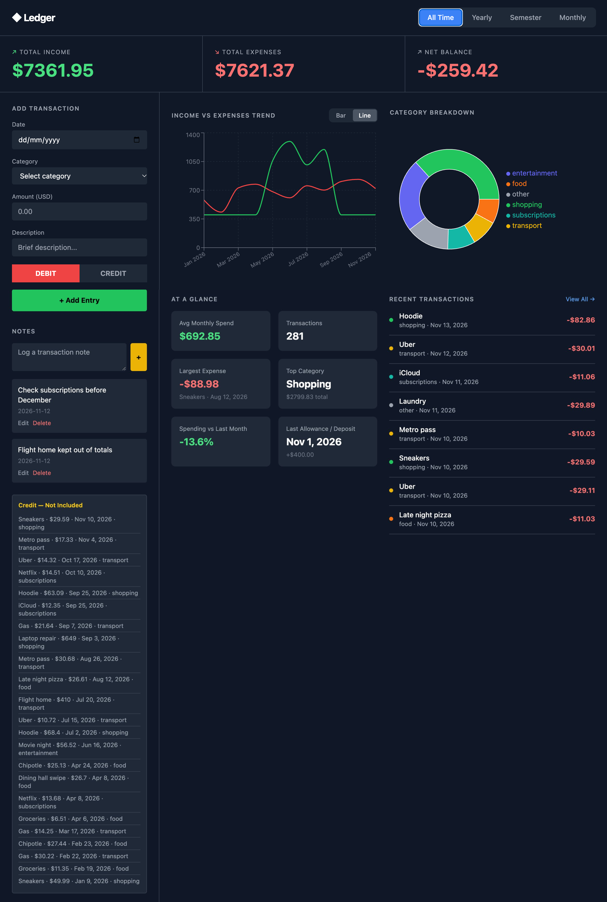
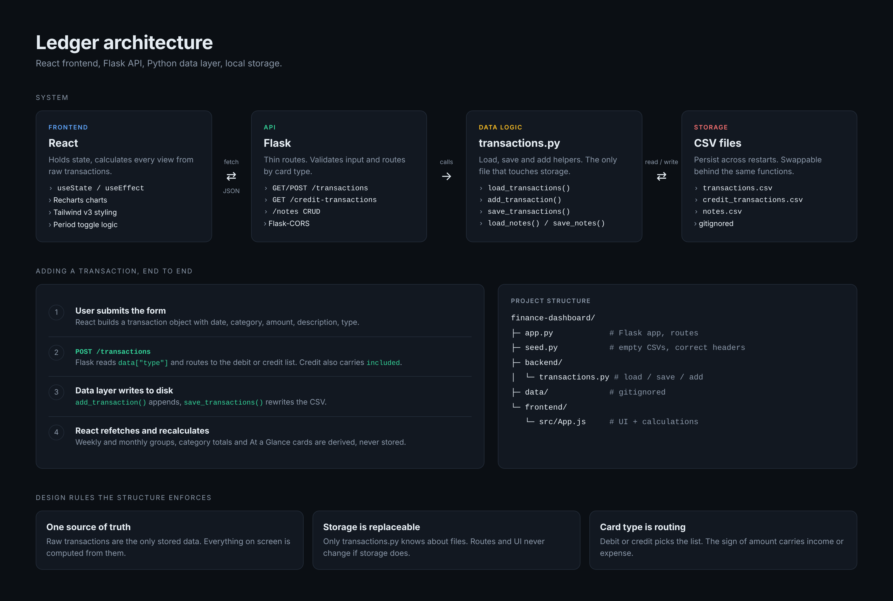

# Ledger: Personal Finance Dashboard

A full-stack personal finance tracker. Log your spending and income, then explore it by week, month, semester, year, or all time.



---

## Features

**Dashboard**
- Summary header: total income, total expenses, net balance
- Income vs. expenses trend, switchable between bar and line charts
- Category breakdown donut chart with hover details (amount and % of spend)
- "At a Glance" cards: average monthly spend, transaction count, largest expense, top category, spending vs. previous period, last allowance/deposit
- Recent transactions (8 most recent) with a "View All" overlay and category filters

**Time-period toggle**
- All Time, Yearly, Semester, and Monthly, with arrow navigation between periods
- Every chart, card, and list responds to the selected period
- Weekly breakdowns in Monthly view

**Two-card model**
- Debit and credit transactions are stored separately
- Credit transactions can be included in or excluded from totals, and are tagged in every list

**Notes**
- Free-text notes with add, inline edit, and delete
- Credit transactions are auto-grouped into "Included" and "Not Included" notes

---

## Product Decisions

**Manual entry, with a known cost.**
Transactions are entered by hand rather than pulled from a bank. That keeps all financial data under the user's control with no third-party credentials involved, and it covers cash and cards that aggregators miss. 

The tradeoff is real: logging every purchase is friction, and friction is where trackers die. The next step is lowering that cost (quick-add, bank-statement import, optional sync) while keeping manual entry as the fallback.

**Debit/Credit means "which card," not "money in or out."**
It routes a transaction to the right account. The sign of `amount` carries income vs. expense.

**Credit transactions can be excluded from totals.**
Large or emergency purchases can be logged without distorting everyday spending patterns. Excluded purchases are listed automatically in a “Not Included” note, so nothing is hidden from you.

**Semesters instead of quarters.**
The toggle mirrors an academic calendar: Spring (Jan to Apr), Summer (May to Aug), Fall (Sep to Nov), Winter (Dec).

**Derived data is computed, not stored.**
Weekly and monthly groupings, category totals, and metrics are recalculated from raw transactions, so there is one source of truth.

**Empty periods show as zero.**
Weeks and months with no transactions render as 0 instead of being skipped, so trends are not misleading.

---

## Tech Stack

| Layer | Technology |
|---|---|
| Frontend | React, Tailwind CSS v3, Recharts |
| API | Flask, Flask-CORS |
| Data logic | Python, pandas |
| Storage | CSV (this repo); swappable for SQLite |

---

## Architecture



<details>
<summary>Project structure</summary>

```
finance-dashboard/
├── app.py                  # Flask app and API routes
├── seed.py                 # Creates empty data files with correct headers
├── backend/
│   └── transactions.py     # Load / save / add, filter and summary helpers
├── data/                   # Data files (gitignored)
└── frontend/
    └── src/App.js          # Dashboard UI and calculations
```
</details>

**Storage note:** this repo ships with a CSV backend. The same load/save functions in `backend/transactions.py` can be pointed at your own SQLite database if you want something sturdier.

### API

| Method | Route | Description |
|---|---|---|
| GET / POST | `/transactions` | List debit transactions / add a transaction |
| GET | `/credit-transactions` | List credit transactions |
| GET / POST | `/notes` | List / create notes |
| PUT / DELETE | `/notes/<id>` | Edit / delete a note |

**Transaction shape**
```json
{
  "date": "2026-06-17",
  "category": "shopping",
  "amount": -32.0,
  "description": "Garage top",
  "type": "debit",
  "included": true
}
```
Expenses are negative, income positive. `included` only affects credit transactions.

---

## Getting Started

**Prerequisites:** Python 3.10+, Node.js 18+

```bash
# Backend
git clone https://github.com/anoushka2006/<repo-name>.git
cd <repo-name>
python -m venv venv && source venv/bin/activate
pip install flask flask-cors pandas
python seed.py
python app.py                # http://127.0.0.1:5000

# Frontend (new terminal)
cd frontend
npm install
npm start                    # http://localhost:3000
```

On macOS, port 5000 can be claimed by AirPlay Receiver (403 errors). Turn it off in System Settings > General > AirDrop & Handoff.

---

## What I Learned

- How a React frontend, Flask API, and storage layer divide responsibilities, and how to trace a bug to the right layer
- Memory vs. persistent storage, and why derived data should be computed rather than saved
- CORS, REST endpoints, and state-driven UI in React
- Turning a Figma design into a working product, and cutting scope along the way

---

**Author:** Anoushka Chaudhury, [GitHub](https://github.com/anoushka2006)